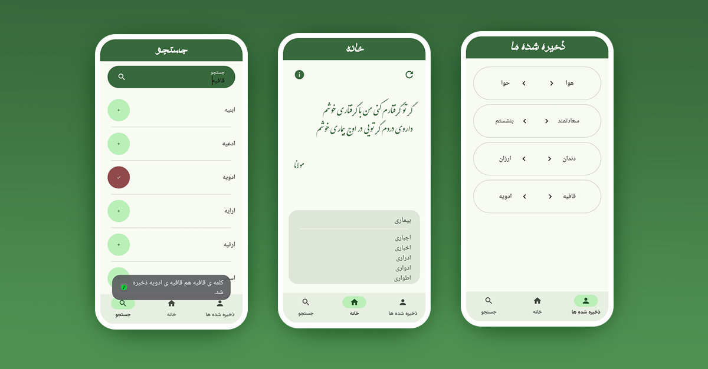
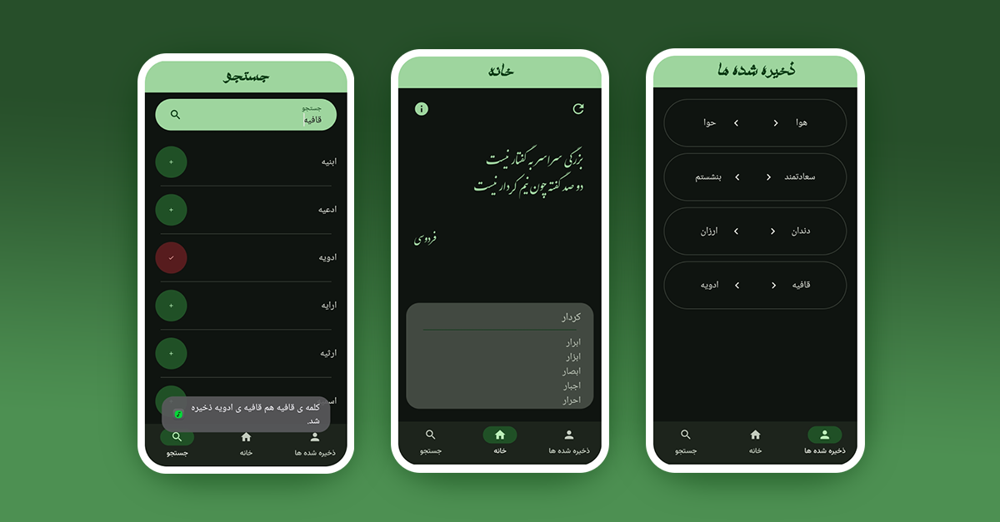

"Are you a poet-wannabe? 🫠
Are you looking forward to write poems in Persian language? 🤨
Do you know every word in Persian language to find well-fitted rhymes for your poems? 🤔
This app is here to help you. 😎
Just search any word, and you'll be given tons of rhymes in this beautiful language. 👌
you're welcome. 😉"
> this app is currently written in Persian language, and has no other versions.

## Light Mode 👇

## Dark Mode 👇

## 📦 Download this app 👇
[Download the APK here](https://github.com/MotamedKia/RhymeFinder/releases/download/apps/HamGhafieh-0.1.3.apk)

##
✅ Now in [cafebazaar.ir](https://cafebazaar.ir/app/com.example.rhymefinder)
